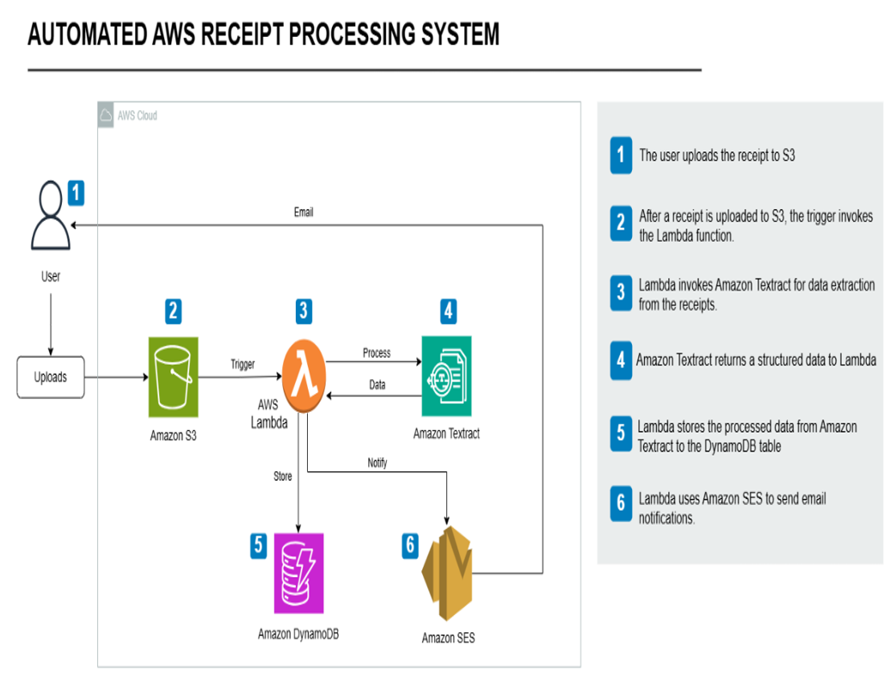
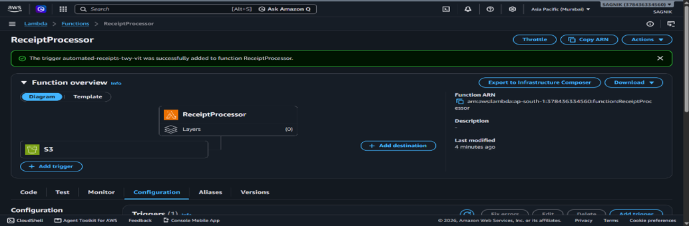
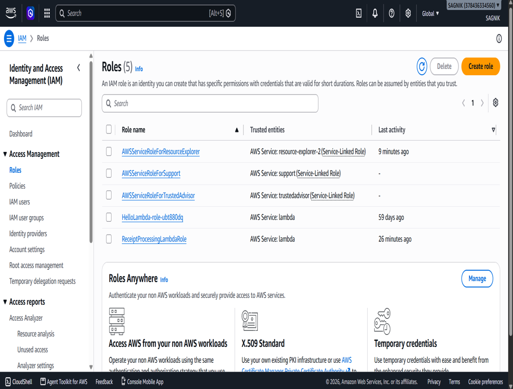
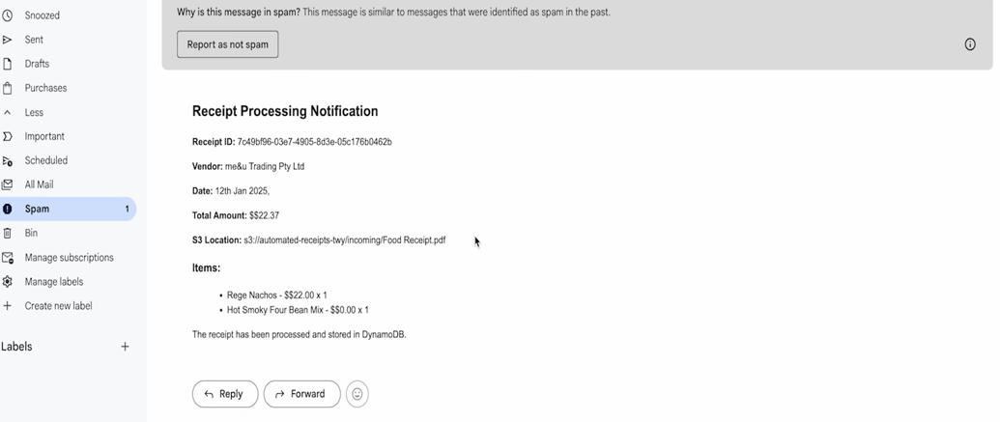

# 🧾 Serverless AWS Receipt Processing System

## Overview ☁️
This project implements a fully automated, event-driven pipeline for receipt processing using AWS serverless technologies. Designed to eliminate manual data entry bottlenecks, this system automatically extracts structured data from uploaded receipts (PDFs/PNGs) and stores it efficiently for auditing, while notifying users in real-time.

## Architecture

The event-driven architecture consists of:
* **Storage Layer (Amazon S3):** Stores incoming receipt images and PDFs. Triggers the Lambda function upon `s3:ObjectCreated:*`.
* **Compute Layer (AWS Lambda):** Acts as the central Python orchestrator using Boto3, processing the payload sequentially with zero idle compute.
* **Processing Layer (Amazon Textract):** Utilizes AI-powered OCR (`analyze_expense` API) to extract vendors, dates, line items, and totals.
* **Database Layer (Amazon DynamoDB):** Stores extracted data in a structured NoSQL format, assigning unique UUIDs to each receipt.
* **Notification System (Amazon SES):** Dispatches formatted HTML email alerts summarizing the processed receipt details.

## Integration & System Outcomes ⚡
* **100% Automated Process:** Zero manual entry required.
* **Real-Time Execution:** End-to-end processing completes in seconds.

### Visual Proof of Execution

Click to view system configurations and outcomes

1. **Lambda Compute Orchestrator:** The trigger automatically processes the S3 drop.

2. **IAM Security:** Strict role-based access for the serverless pipeline.

3. **SES Delivery:** Formatted email successfully received displaying the Textract and DynamoDB pipeline outcome.

## Cloud Resource Clean Up 🗑️
To prevent unexpected AWS charges, ensure all resources are dismantled after testing:
1. **Empty & Delete S3:** Remove all uploaded receipt files and delete the bucket.
2. **Stop Textract Processing:** Halt calls to prevent extra API costs.
3. **Delete DynamoDB Table:** Remove stored receipt data and the table.
4. **Disable SES Notifications:** Remove verified email addresses.
5. **Remove IAM Roles:** Delete the execution role created for the Lambda function.

## Future Enhancements
* Implement Infrastructure as Code (IaC) using Terraform or AWS SAM for one-click deployment.
* Add an SQS Dead Letter Queue (DLQ) to catch and retry failed Textract processing events.
* Build a frontend UI using Streamlit or FastAPI to allow users to upload receipts via a web browser and view a spending dashboard.

---
**Author:** Sagnik Biswas 
**Course:** Advanced Cloud Computing (BECE355L)
